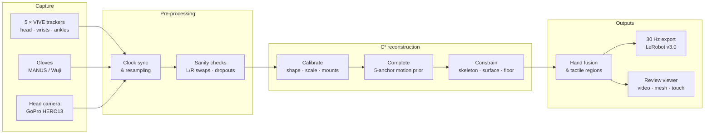
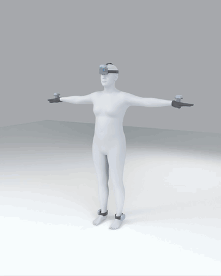

<div align="center">


<h1>EgoExplorer</h1>

<h3>A Vision–Motion–Touch Observatory for Human Loco-Manipulation In Situ</h3>

<p>
<a href="#"></a>
<a href="#"></a>
<a href="https://huggingface.co/datasets/InternRobotics/EgoExplorer"></a>
<a href="#release-plan"></a>
</p>

<b>The capture-and-reconstruction toolkit behind EgoExplorer:<br/>
five body trackers, two gloves and a head camera in — metric SMPL-X, hands, touch and video on one 30 Hz clock out.</b>

</div>

> [!NOTE]
> **The toolkit code is being cleaned up and is expected in early November 2026.** This page describes what it does and how the pipeline is put together. Watch or star the repository to be notified. The data produced with it is already available on [Hugging Face](https://huggingface.co/datasets/InternRobotics/EgoExplorer).

## Why a toolkit

Humanoids are built for human spaces, and almost nothing useful in those spaces happens standing still. A person fetching a reagent walks to the bench, leans in, adjusts their stance so both hands can reach, and keeps the grasp while they turn away. Recording that behaviour means recording **what the person saw, how the whole body moved, what every finger did and where the hands actually pressed** — together, in rooms nobody instrumented.

Optical motion capture needs a studio. Egocentric video scales but leaves the body unobserved. EgoExplorer takes a third route: a light **wearable rig** of sparse sensors, and a **reconstruction pipeline** that turns those sparse measurements into a full, metric, physically plausible human. This repository is that route, end to end.

## Contents

- [Pipeline at a glance](#pipeline-at-a-glance)
- [Capture rig](#capture-rig)
- [Four streams, one clock](#four-streams-one-clock)
- [Reconstruction: Calibrate, Complete, Constrain](#reconstruction-calibrate-complete-constrain)
- [Hands and touch](#hands-and-touch)
- [From reconstruction to data](#from-reconstruction-to-data)
- [Release plan](#release-plan)
- [Citation](#citation)

## Pipeline at a glance



## Capture rig

**Five anchors, two gloves, one camera.** Everything mounts on the body in a few minutes, survives a day of real work, and leaves the wearer free to do their actual job. Nothing stands in the room: no tripod, no base station, no line of sight to keep clear.

<table>
<tr>
<td width="38%" align="center"></td>
<td>

| | |
| :--- | :--- |
| **Body** | 5 × VIVE Ultimate Tracker — head, wrists, ankles; inside-out, no base stations |
| **Vision** | GoPro HERO13 Black with Media Mod, bolted to the head tracker through a printed adapter |
| **Hands** | MANUS Metagloves Pro (articulation) **or** Wuji gloves (articulation + 17-region tactile) |
| **Mounts** | Custom 3D-printed, glove dorsum and lateral ankle, strapped |
| **Setup** | One calibration per mounting configuration, reused across every task recording |

The head coupling turns the camera pose into a *measured* quantity instead of something to solve for later. Participant geometry and mount placement are solved **once**, before any task is recorded — a session costs a donning and a short calibration, not a re-rig.

</td>
</tr>
</table>

## Four streams, one clock

| | Stream | Source | Native rate | What the toolkit produces |
| :-: | :--- | :--- | :--- | :--- |
| **A** | 🎥 Egocentric video | GoPro HERO13 + Media Mod, rigid to the head tracker | 30 Hz, 1920×970 | Frames with a *measured* camera pose |
| **B** | 🧍 Whole-body motion | 5 × VIVE Ultimate Tracker → C³ | 60 Hz | Metric SMPL-X body, incl. the 17 joints no tracker sees |
| **C** | ✋ Finger articulation | MANUS Metagloves Pro or Wuji gloves | ~120 Hz | SMPL-X hand pose for both hands, measured rather than inferred from pixels |
| **D** | 🔥 Tactile contact | Wuji glove, 24×31 taxels per hand | ~120 Hz | Calibrated taxels + binary contact over 17 anatomical regions per hand |

<p align="center">

<br/><sub>One recording (weighing), sped up: egocentric video, whole-body motion, hand skeletons with tactile contact, and the step description, all on one timeline.</sub>
</p>

## Reconstruction: Calibrate, Complete, Constrain

Sparse sensing moves the cost from hardware to reconstruction. A tracker pose is the product of two unknowns — where the device sits on the limb, and how the limb is articulated — and fitting them together quietly turns a mounting error into a pose error. Our pipeline, **C³**, refuses to solve them at the same time.

1. **Calibrate.** A short prescribed sequence, matched by phase against a reference motion library, gives body shape, metric scale and each sensor-to-anchor transform — fixed before any motion is inferred.
2. **Complete.** A temporal prior (AvatarPoser extended from three anchors to five, trained on AMASS) turns the calibrated anchors into a first whole-body trajectory, supplying the joints no tracker observes.
3. **Constrain.** Three layers refine that trajectory jointly — against the measurements (skeleton), against the body's own surface (clearance), and against the floor (every posed vertex).

<p align="center">

<br/><sub>One real recording (sandwich making). The trailing gizmos are the tracker poses; the body is the solved SMPL-X.</sub>
</p>

| Body-point error vs. tracker-fitted references | All joints | 17 unobserved joints |
| :--- | :-: | :-: |
| AvatarPoser, retrained on all five anchors | 64.1 mm | — |
| **EgoExplorer C³** | **18.0 mm** | **20.3 mm** |

The near-flat margin between the two columns is the point: a method that merely snapped to its anchors would be tight at the five trackers and loose at the elbows and knees.

## Hands and touch

Fingers and contact are **measured, not estimated**. The calibrated wrist transform carries each glove's frame onto the solved arm, so finger articulation and pressure land on the same body, on the same clock.

- **Glove → SMPL-X hands.** MANUS and Wuji skeletons are retargeted onto the SMPL-X hand (45 DoF per hand).
- **Tactile pipeline.** Raw Wuji taxels go through per-sensor health masks, baseline removal and layout correction onto a canonical 24×31 grid, then are pooled into 17 anatomical regions per hand.
- **Contact at 30 Hz.** Any valid native-rate detection inside a 1/30 s bin is kept, so brief touches survive resampling.

## From reconstruction to data

The last stage packages every stream into one export, and a viewer for checking it:

- **30 Hz unified export** — tracker poses, SMPL-X body and hands, glove skeletons, tactile and contact, all on one timeline with validity masks (missing streams are never written as zeros).
- **LeRobot v3.0 conversion** — the format used for the [EgoExplorer dataset](https://huggingface.co/datasets/InternRobotics/EgoExplorer).
- **Review viewer** — a browser page per recording with the egocentric video, the SMPL-X mesh with hands, and both tactile maps side by side, plus a gallery that flags tracker drift, left/right swaps and glove dropouts across a whole batch.
- **Batch runner** — resumable, multi-GPU processing of large numbers of recordings.

Because the rig carries no room-side infrastructure, each capture space can be reconstructed once and every session replayed inside its own geometry:

<p align="center">

</p>

## Release plan

- [x] Dataset preview on [Hugging Face](https://huggingface.co/datasets/InternRobotics/EgoExplorer)
- [ ] **Toolkit code — expected early November 2026**
  - [ ] Stream synchronisation and sanity checks
  - [ ] C³ reconstruction: calibration, five-anchor motion prior, constrained refinement
  - [ ] Glove retargeting and tactile processing
  - [ ] 30 Hz export, LeRobot conversion and review viewer
- [ ] Paper

## Citation

If EgoExplorer is useful in your work, please cite:

```bibtex
@misc{egoexplorer2026,
  title  = {EgoExplorer: A Vision-Motion-Touch Observatory for
            Human Loco-Manipulation In Situ},
  author = {Anonymous authors},
  year   = {2026},
  note   = {Paper under double-blind review}
}
```

<div align="center">
<br/>

</div>
