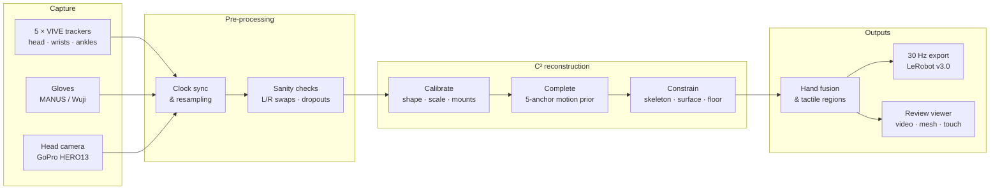

<div align="center">


<h1>EgoExplorer</h1>

<h3>A Vision–Motion–Touch Observatory for Human Loco-Manipulation In Situ</h3>

<p>
<a href="https://huggingface.co/papers/2610.18872"></a>
<a href="https://internrobotics.github.io/egoexplorer.github.io/"></a>
<a href="https://huggingface.co/datasets/InternRobotics/EgoExplorer"></a>
<a href="https://internrobotics.github.io/EgoExplorer-Guidelines/"></a>
</p>

**English** | [中文](README_zh.md)

<b>The capture-and-reconstruction toolkit behind EgoExplorer:<br/>
five body trackers, two gloves and a head camera in — metric SMPL-X, hands, touch and video on one 30 Hz clock out.</b>

</div>

## Why a toolkit

Humanoids are built for human spaces, and almost nothing useful in those spaces happens standing still. A person fetching a reagent walks to the bench, leans in, adjusts their stance so both hands can reach, and keeps the grasp while they turn away. Recording that behaviour means recording **what the person saw, how the whole body moved, what every finger did and where the hands actually pressed** — together, in rooms nobody instrumented.

Optical motion capture needs a studio. Egocentric video scales but leaves the body unobserved. EgoExplorer takes a third route: a light **wearable rig** of sparse sensors, and a **reconstruction pipeline** that turns those sparse measurements into a full, metric, physically plausible human. This repository is that route, end to end.

<p align="center">

<br/><sub>Ten task templates recorded with the rig and MANUS Metagloves, one head-camera view each: six laboratory procedures (top) and four household and industrial tasks (bottom).</sub>
</p>

## Contents

**Overview** · [Pipeline at a glance](#pipeline-at-a-glance) · [Capture rig](#capture-rig) · [Four streams, one clock](#four-streams-one-clock) · [Reconstruction](#reconstruction-calibrate-complete-constrain) · [Hands and touch](#hands-and-touch) · [From reconstruction to data](#from-reconstruction-to-data)

**Using the toolkit** · [Repository layout](#repository-layout) · [Installation](#installation) · [Quick start](#quick-start) · [Wuji tactile](#wuji-tactile) · [Retraining](#retraining-the-proposal-network) · [Known limitations](#known-limitations)

[Release plan](#release-plan) · [Citation](#citation)

## Pipeline at a glance



## Capture rig

**Five anchors, two gloves, one camera.** Everything mounts on the body in a few minutes, survives a day of real work, and leaves the wearer free to do their actual job. Nothing stands in the room: no tripod, no base station, no line of sight to keep clear.

<table>
<tr>
<td width="38%" align="center"></td>
<td>

| | |
| :--- | :--- |
| **Body** | 5 × VIVE Ultimate Tracker — head, wrists, ankles; inside-out, no base stations |
| **Vision** | GoPro HERO13 Black with Media Mod, bolted to the head tracker through a printed adapter |
| **Hands** | MANUS Metagloves Pro (articulation) **or** Wuji gloves (articulation + 17-region tactile) |
| **Mounts** | Custom 3D-printed, glove dorsum and lateral ankle, strapped |
| **Setup** | One calibration per mounting configuration, reused across every task recording |

The head coupling turns the camera pose into a *measured* quantity instead of something to solve for later. Participant geometry and mount placement are solved **once**, before any task is recorded — a session costs a donning and a short calibration, not a re-rig.

</td>
</tr>
</table>

## Four streams, one clock

| | Stream | Source | Native rate | What the toolkit produces |
| :-: | :--- | :--- | :--- | :--- |
| **A** | 🎥 Egocentric video | GoPro HERO13 + Media Mod, rigid to the head tracker | 30 Hz, 1920×970 | Frames with a *measured* camera pose |
| **B** | 🧍 Whole-body motion | 5 × VIVE Ultimate Tracker → C³ | 60 Hz | Metric SMPL-X body, incl. the 17 joints no tracker sees |
| **C** | ✋ Finger articulation | MANUS Metagloves Pro or Wuji gloves | ~120 Hz | SMPL-X hand pose for both hands, measured rather than inferred from pixels |
| **D** | 🔥 Tactile contact | Wuji glove, 24×31 taxels per hand | ~120 Hz | Calibrated taxels + binary contact over 17 anatomical regions per hand |

<p align="center">

<br/><sub>One recording (weighing), sped up: egocentric video, whole-body motion, hand skeletons with tactile contact, and the step description, all on one timeline.</sub>
</p>

## Reconstruction: Calibrate, Complete, Constrain

Sparse sensing moves the cost from hardware to reconstruction. A tracker pose is the product of two unknowns — where the device sits on the limb, and how the limb is articulated — and fitting them together quietly turns a mounting error into a pose error. Our pipeline, **C³**, refuses to solve them at the same time.

1. **Calibrate.** A short prescribed sequence, matched by phase against a reference motion library, gives body shape, metric scale and each sensor-to-anchor transform — fixed before any motion is inferred.
2. **Complete.** A temporal prior (AvatarPoser extended from three anchors to five, trained on AMASS) turns the calibrated anchors into a first whole-body trajectory, supplying the joints no tracker observes.
3. **Constrain.** Three layers refine that trajectory jointly — against the measurements (skeleton), against the body's own surface (clearance), and against the floor (every posed vertex).

<p align="center">

<br/><sub>One real recording (sandwich making). The trailing gizmos are the tracker poses; the body is the solved SMPL-X.</sub>
</p>

| Body-point error vs. tracker-fitted references | All joints | 17 unobserved joints |
| :--- | :-: | :-: |
| AvatarPoser, retrained on all five anchors | 64.1 mm | — |
| **EgoExplorer C³** | **18.0 mm** | **20.3 mm** |

The near-flat margin between the two columns is the point: a method that merely snapped to its anchors would be tight at the five trackers and loose at the elbows and knees.

## Hands and touch

Fingers and contact are **measured, not estimated**. The calibrated wrist transform carries each glove's frame onto the solved arm, so finger articulation and pressure land on the same body, on the same clock.

- **Glove → SMPL-X hands.** MANUS and Wuji skeletons are retargeted onto the SMPL-X hand (45 DoF per hand).
- **Tactile pipeline.** Raw Wuji taxels go through per-sensor health masks, baseline removal and layout correction onto a canonical 24×31 grid, then are pooled into 17 anatomical regions per hand.
- **Contact at 30 Hz.** Any valid native-rate detection inside a 1/30 s bin is kept, so brief touches survive resampling.

## From reconstruction to data

The last stage packages every stream into one export, and a viewer for checking it:

- **30 Hz unified export** — tracker poses, SMPL-X body and hands, glove skeletons, tactile and contact, all on one timeline with validity masks (missing streams are never written as zeros).
- **LeRobot v3.0 conversion** — the format used for the [EgoExplorer dataset](https://huggingface.co/datasets/InternRobotics/EgoExplorer).
- **Review viewer** — a browser page per recording with the egocentric video, the SMPL-X mesh with hands, and both tactile maps side by side, plus a gallery that flags tracker drift, left/right swaps and glove dropouts across a whole batch.
- **Pipeline runner** — one command runs every stage on a single machine and resumes where it stopped.

Because the rig carries no room-side infrastructure, each capture space can be reconstructed once and every session replayed inside its own geometry:

<p align="center">

</p>

## Repository layout

| Path | Contents |
| :--- | :--- |
| `capture/` | Recorder for both glove rigs, tracker sender, session viewer ([`capture/README.md`](capture/README.md)) |
| `hardware/` | Bill of materials and 3D-printed parts ([`hardware/README.md`](hardware/README.md)) |
| `src/five_tracker_smplx/` | Core library: data loading, coordinates, subject calibration, SMPL-X fitting, hand mapping, viewer |
| `scripts/` | One script per pipeline stage; single-machine entry point `scripts/run_pipeline.sh` |
| `tactile/` | Wuji touch pipeline (L0 → L4), channel map, glove health table and the scripts that rebuild it |
| `ckpt/avatarposer_five/` | Proposal network (`model.pt`) and its training report |
| `profiles/` | Two production subject profiles (`collector_a`, `collector_b`) |
| `assets/` | Calibration reference motions and video, protocol pose library, B01–B10 guide poses |
| `docs/` | Glove skeleton → MANO / SMPL-X mapping ([`docs/glove_to_mano.md`](docs/glove_to_mano.md)); images for this page in `docs/media/` |
| `models/` | SMPL-X and VPoser — not distributed, see [Installation](#installation) |

## Installation

```bash
conda create -n egoexplorer python=3.10 -y && conda activate egoexplorer
pip install torch                 # pick the build for your CUDA version
pip install -e ".[all]"
```

Register at the [SMPL-X website](https://smpl-x.is.tue.mpg.de/), download the models under its licence, and place them as follows:

```text
models/smplx/SMPLX_NEUTRAL.npz
models/vposer/V02_05/V02_05.yaml
models/vposer/V02_05/snapshots/V02_05_epoch=13_val_loss=0.03.ckpt
```

`ffmpeg` must be on the `PATH` for the review pages.

## Quick start

One pass from a recording to the exported data. Hardware, wearing, the calibration protocol, data formats and coordinate conventions are documented in the [EgoExplorer Guidelines](https://internrobotics.github.io/EgoExplorer-Guidelines/).

### 1. Capture

The recorder supports two glove rigs:

| Rig | Machines | Run |
| :--- | :--- | :--- |
| **Wuji** (articulation + touch) | Linux recorder + Windows tracker sender | `record_ego_wuji.py` on Linux, `tracker_sender_windows.py` on Windows |
| **MANUS** (articulation) | One Windows machine | `record_ego_manus.py` |

- The MANUS UDP sender is downloaded separately; see [`capture/ManusClient/README.md`](capture/ManusClient/README.md), which also documents the packet format.
- Wuji calibration bundles are created and exported with `capture/scripts/wuji_calibration_tool.py` (Guidelines §2.3).
- Replay a recording with `python capture/visualize_session.py <session dir>`.

Setup, network configuration, recorder flags and troubleshooting are in [`capture/README.md`](capture/README.md) and Guidelines chapters 2–4.

### 2. Calibrate each donning

A **batch** is one subject in one donning. Arrange the work folder like this:

```text
$WORK/ego_data_sync/<batch>/<session>/   raw recordings: *.tracker.npz / *.npz / *.video.npz / *.mp4 / *.session.json
$WORK/profiles/<batch>.json              subject profile for the batch
```

Record calibration motions 01–17 once per donning (follow `assets/calibration_protocol_reference.mp4`), then solve the subject profile:

```bash
PYTHONPATH=src python -m five_tracker_smplx.cli calibrate-subject \
  --data <folder with this donning's 01–17 recordings> --height <height_m> --armspan <armspan_m> \
  --output-dir $WORK/profiles/calib_<batch> --device cpu
cp $WORK/profiles/calib_<batch>/subject_profile.json $WORK/profiles/<batch>.json
```

Open `subject_calibration.html` in the output folder before going on: per-tracker residuals on the static segments should stay within 3–4 cm.

### 3. Run the pipeline

```bash
WORK=/path/to/work bash scripts/run_pipeline.sh all            # every batch
WORK=/path/to/work bash scripts/run_pipeline.sh all <batch>    # selected batches
WORK=/path/to/work bash scripts/run_pipeline.sh status         # progress per stage
```

`all` runs the stages below in order. Each one can also be run on its own and skips sessions that are already done, so an interrupted run can be resumed.

| Stage | What it does |
| :--- | :--- |
| `check` | Reports tracker L/R swaps, starting stance, glove pairing and handedness |
| `fix` | Writes L/R-corrected copies; originals are left untouched |
| `view` | Builds the merged input: corrected copy where one exists, raw otherwise |
| `project` | Reference → proposal → L1/L2/L3 projection; a diverged session is retried once at half the learning rate |
| `fuse` | Maps glove data to MANO and fuses the hands into the body |
| `export` | Writes one unified 30 Hz `.npz` per session; sessions whose body failed get a video + touch export in `unified_30hz_nobody/` |
| `drift` | Tracker drift report from the projection residuals |
| `review` | Three-pane review pages (video · mesh · touch) |
| `gallery` | Overview page with every QC flag |

**Outputs**

| Output | Location |
| :--- | :--- |
| SMPL-X, body only | `$WORK/out/projected/<sid>/smplx_profile_driven.npz` |
| SMPL-X, body + fingers | `$WORK/out/projected/<sid>/smplx_with_manus_hands.npz` |
| **Unified 30 Hz export** (use this downstream) | `$WORK/out/unified_30hz/<sid>.npz` |
| Review page | `$WORK/out/review/<slug>.review.html` |
| Overview and QC flags | `$WORK/out/gallery/index.html` |

Environment variables: `PY` (Python interpreter), `DEVICE` (`cuda` if available, else `cpu`), `CKPT` (proposal checkpoint), `BODY` (SMPL-X folder).

**Configuration.** The defaults of `scripts/run_five_tracker_pipeline.py` are the production settings used for the released data: 60 Adam steps, lr 0.004, chunks of 256 frames; L1 joint limits (knee 125°, elbow 140°, trunk flexion 90°, knee hyperextension 100, pelvis roll 100); L2 `signed_top8` surface term (weight 3000, 1.8 cm, 256 samples); L3 floor penetration 50.

**Tested** end to end on a CPU-only Mac with one real Wuji recording (192 s): projection took about 34 min, with median per-tracker residuals of 1.6–2.9 mm (p95 4.6–7.4 mm), on par with the production batches. Re-running `calibrate-subject` on the original calibration recordings reproduces the production profile exactly.

### 4. Convert to LeRobot v3.0

```bash
python scripts/build_lerobot_dataset.py --episodes episodes.csv \
  --raw-root $WORK/input/ego_data_sync --unified-root $WORK/out/unified_30hz \
  --projected-root $WORK/out/projected --output $WORK/out/lerobot
```

`episodes.csv` has one row per episode: `session,task_zh,task_en,environment_type[,trim_head_s,trim_tail_s]`.

- Videos are re-encoded to strict 30 fps CFR, with the top 110 px cropped.
- Trackers are interpolated from ~65 Hz onto the video frame times; quaternions are written as `w, x, y, z`.
- Hands, touch and SMPL-X come from the unified 30 Hz export.
- The run ends with a self-check of parquet rows against video frames and the time grid.

The dataset layout is described in Guidelines chapter 10.

## Wuji tactile

`export_unified_30hz.py` loads `wuji_correct.py`, `wuji_layout.py` and `health/health_db.npz` from `tactile/` (override with `EGOEXPLORER_TACTILE_DIR`). It outputs L1/L2/L4 signals for 17 regions per hand, plus 6 coarse regions.

> [!IMPORTANT]
> The glove health table covers recordings from **2026-09-01 to 2026-09-08**. Later sessions fall back to its last day. Rebuild it for new gloves or new data:
>
> ```bash
> python tactile/per_session_stats.py <folder of Wuji sessions>    # -> tactile/stats/
> python tactile/build_health.py                                   # -> tactile/health/
> ```

## Retraining the proposal network

The recipe is in Guidelines §7.7. You will additionally need `avatarposer.pth` from the [official AvatarPoser](https://github.com/eth-siplab/AvatarPoser) release and AMASS. Relevant scripts:

- `generate_sparse_tracker_synthetic.py`
- `generate_amass_five_tracker_synthetic.py`
- `build_pose_reference.py` (with `assets/protocol_body_poses.json` and `assets/guides/`)
- `train_avatarposer_five_tracker.py`

## Known limitations

- **Profiles are explicit.** Each batch needs its own `profiles/<batch>.json`; profiles are not selected automatically.
- **Missing synthetic-data script.** The script that turned the B01–B10 guide poses into synthetic training sequences (`make_reference_synthetic.py`) was not preserved and must be rewritten for retraining. The other synthetic and natural data paths are unaffected.
- **Camera extrinsic not calibrated.** The head camera's extrinsic relative to the head tracker has not been calibrated separately.

## Release plan

- [x] Paper ([arXiv 2610.18872](https://arxiv.org/abs/2610.18872))
- [x] Dataset preview on [Hugging Face](https://huggingface.co/datasets/InternRobotics/EgoExplorer)
- [x] Toolkit code
  - [x] Capture programs for the MANUS and Wuji rigs
  - [x] Stream synchronisation and sanity checks
  - [x] C³ reconstruction: calibration, five-anchor motion prior, constrained refinement
  - [x] Glove retargeting and tactile processing
  - [x] 30 Hz export, LeRobot conversion and review viewer
- [ ] Hardware bill of materials and print settings ([`hardware/`](hardware/README.md))

## Citation

If EgoExplorer is useful in your work, please cite:

```bibtex
@misc{zhou2026egoexplorer,
      title={EgoExplorer: A Vision-Motion-Touch Observatory for Human Loco-Manipulation In Situ}, 
      author={Yunsong Zhou and Xuekun Jiang and Haiqi Shen and Hangxu Liu and Chaojian Shi and Yujie Liu and Jingyuan Li and Haoran Yang and Jiafei Cao and Dongzhan Zhou and Dong Wang and Yao Mu and Chunhua Shen and Weinan Zhang},
      year={2026},
      eprint={2610.18872},
      archivePrefix={arXiv},
      primaryClass={cs.RO},
      url={https://arxiv.org/abs/2610.18872}, 
}
```

<div align="center">
<br/>

</div>
