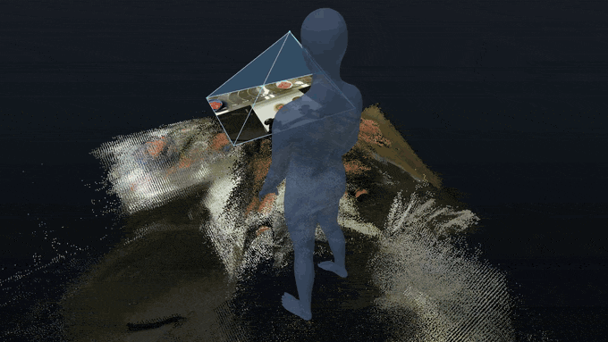
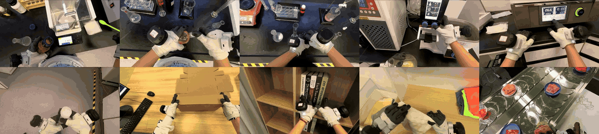
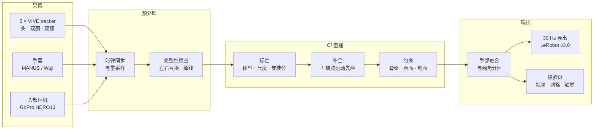
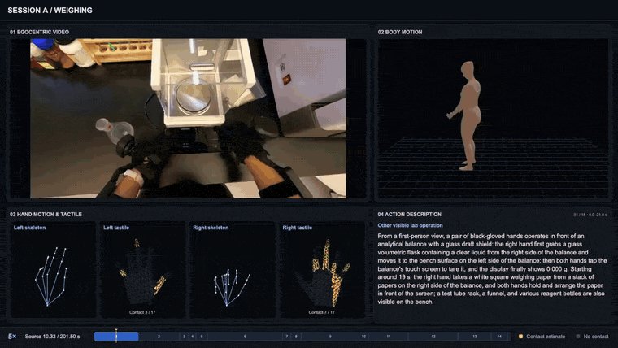
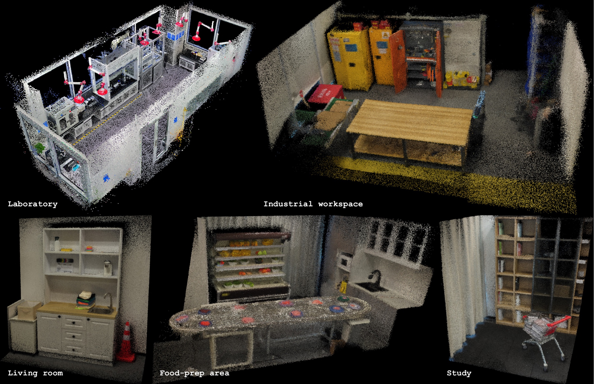

<div align="center">



<h1>EgoExplorer</h1>

<h3>A Vision–Motion–Touch Observatory for Human Loco-Manipulation In Situ</h3>

<p>
<a href="https://huggingface.co/papers/2610.18872"></a>
<a href="https://internrobotics.github.io/egoexplorer.github.io/"></a>
<a href="https://huggingface.co/datasets/InternRobotics/EgoExplorer"></a>
<a href="https://internrobotics.github.io/EgoExplorer-Guidelines/"></a>
</p>

[English](README.md) | **中文**

<b>EgoExplorer 背后的采集与重建工具包：<br/>
输入五个身体 tracker、一副手套和一台头部相机，输出统一在 30 Hz 时钟上的度量尺度 SMPL-X、手部、触觉与视频。</b>

</div>

## 为什么需要这套工具

人形机器人是为人类空间造的，而这些空间里有用的事几乎都不是站着不动完成的。一个人去取试剂，会走到实验台前、俯身、调整站位让双手都够得着，转身离开时手上的抓握还要保持住。要记录这样的行为，就要同时记录**人看到了什么、全身怎么动、每根手指做了什么、手实际按在了哪里**，而且是在没有任何布设的真实房间里。

光学动捕需要专门的场地；第一视角视频容易规模化，却看不到身体。EgoExplorer 走第三条路：一套轻量的**穿戴式稀疏传感器**，加上一条把稀疏测量重建为完整、度量尺度、物理合理人体的**重建管线**。本仓库就是这条路的完整实现。

<p align="center">

<br/><sub>用这套设备和 MANUS 手套录制的十个任务模板，每个一段头部相机画面：上排为六个实验室流程，下排为四个家居与工业任务。</sub>
</p>

## 目录

**概览** · [管线一览](#管线一览) · [采集设备](#采集设备) · [四路数据，一个时钟](#四路数据一个时钟) · [重建：标定、补全、约束](#重建标定补全约束) · [手与触觉](#手与触觉) · [从重建到数据](#从重建到数据)

**使用工具包** · [仓库结构](#仓库结构) · [安装](#安装) · [快速开始](#快速开始) · [Wuji 触觉](#wuji-触觉) · [重新训练](#重新训练-proposal-网络) · [已知限制](#已知限制)

[发布计划](#发布计划) · [引用](#引用)

## 管线一览



## 采集设备

**五个锚点、一副手套、一台相机。** 所有部件几分钟就能穿戴好，能撑过一整天的真实工作，也不妨碍穿戴者做自己的事。房间里不需要任何东西：没有三脚架，没有基站，也不用保持视线通畅。

<table>
<tr>
<td width="38%" align="center"></td>
<td>

| | |
| :--- | :--- |
| **身体** | 5 × VIVE Ultimate Tracker：头、双腕、双踝；inside-out 定位，无需基站 |
| **视觉** | GoPro HERO13 Black + Media Mod，通过打印转接件固定在头部 tracker 上 |
| **手** | MANUS Metagloves Pro（关节）**或** Wuji 手套（关节 + 17 区触觉） |
| **固定件** | 定制 3D 打印件，装在手套手背和脚踝外侧，用绑带固定 |
| **准备** | 每种穿戴配置标定一次，之后所有任务录制都复用 |

头部的刚性连接让相机位姿成为*测量量*，而不是事后再求解的未知量。受试者体型和安装位置在录制任何任务之前**一次性**求解：每次录制只需要穿戴和一段简短标定，不需要重新装配。

</td>
</tr>
</table>

## 四路数据，一个时钟

| | 数据流 | 来源 | 原始频率 | 工具包输出 |
| :-: | :--- | :--- | :--- | :--- |
| **A** | 🎥 第一视角视频 | GoPro HERO13 + Media Mod，与头部 tracker 刚性连接 | 30 Hz，1920×970 | 带*实测*相机位姿的视频帧 |
| **B** | 🧍 全身运动 | 5 × VIVE Ultimate Tracker → C³ | 60 Hz | 度量尺度 SMPL-X 人体，包括没有 tracker 直接观测的 17 个关节 |
| **C** | ✋ 手指关节 | MANUS Metagloves Pro 或 Wuji 手套 | ~120 Hz | 双手 SMPL-X 手部姿态，直接测量而非从图像推断 |
| **D** | 🔥 触觉接触 | Wuji 手套，每只手 24×31 个触点 | ~120 Hz | 校准后的触点读数 + 每只手 17 个解剖区域的二值接触 |

<p align="center">

<br/><sub>一条录制（称量），加速播放：第一视角视频、全身运动、带触觉接触的手部骨架和步骤说明，都在同一条时间轴上。</sub>
</p>

## 重建：标定、补全、约束

稀疏传感把成本从硬件转移到了重建。一个 tracker 的位姿是两个未知量的乘积：设备装在肢体的哪个位置，以及肢体本身怎么摆。把两者一起拟合，安装误差会悄悄变成姿态误差。我们的管线 **C³** 坚持不同时求解它们。

1. **标定（Calibrate）。** 一段规定的标定动作按阶段与参考动作库对齐，得到体型、度量尺度和每个传感器到锚点的变换；这些在推断任何运动之前就固定下来。
2. **补全（Complete）。** 一个时序先验（把 AvatarPoser 从三锚点扩展到五锚点，在 AMASS 上训练）把标定后的锚点变成初始全身轨迹，补上 tracker 观测不到的关节。
3. **约束（Constrain）。** 三层约束联合优化这条轨迹：对测量（骨架）、对身体自身表面（避免穿插）、对地面（所有顶点）。

<p align="center">

<br/><sub>一条真实录制（做三明治）。拖尾的坐标轴是 tracker 位姿，人体是求解出的 SMPL-X。</sub>
</p>

| 相对 tracker 拟合参考的身体点误差 | 全部关节 | 17 个未观测关节 |
| :--- | :-: | :-: |
| AvatarPoser，用全部五个锚点重新训练 | 64.1 mm | — |
| **EgoExplorer C³** | **18.0 mm** | **20.3 mm** |

两列几乎持平才是关键：一个只是贴合锚点的方法，会在五个 tracker 处很准，而在手肘和膝盖处明显变差。

## 手与触觉

手指和接触是**测量出来的，不是估计出来的**。标定得到的腕部变换把每只手套的坐标系接到求解出的手臂上，因此手指关节和压力落在同一个身体、同一个时钟上。

- **手套 → SMPL-X 手部。** MANUS 和 Wuji 的骨架被重定向到 SMPL-X 手部（每只手 45 个自由度）。
- **触觉管线。** Wuji 原始触点经过逐传感器健康掩码、基线去除和布局校正，映射到标准 24×31 网格，再汇总成每只手 17 个解剖区域。
- **30 Hz 接触。** 1/30 s 时间格内只要有一次有效的原始频率检测就保留，短暂的触碰不会在重采样中丢失。

## 从重建到数据

最后一步把所有数据流打包成一份导出，并提供用于检查的校验页：

- **30 Hz 统一导出**：tracker 位姿、SMPL-X 身体与手、手套骨架、触觉与接触，都在同一时间轴上，并带有效性掩码（缺失的数据流不会写成零）。
- **LeRobot v3.0 转换**：[EgoExplorer 数据集](https://huggingface.co/datasets/InternRobotics/EgoExplorer)使用的格式。
- **校验页**：每条录制一个浏览器页面，并排显示第一视角视频、带手的 SMPL-X 网格和两只手的触觉图；另有一个总览页，标出整个 batch 中的 tracker 漂移、左右互换和手套掉线。
- **管线入口**：一条命令在单机上跑完所有阶段，中断后可以续跑。

由于设备不依赖房间内的任何设施，每个采集空间只需重建一次，所有录制都可以在各自的场景几何中回放：

<p align="center">

</p>

## 仓库结构

| 路径 | 内容 |
| :--- | :--- |
| `capture/` | 两种手套方案的采集程序、tracker 发送端、会话回看（[`capture/README_zh.md`](capture/README_zh.md)） |
| `hardware/` | 采购清单与 3D 打印件（[`hardware/README_zh.md`](hardware/README_zh.md)） |
| `src/five_tracker_smplx/` | 核心库：数据读取、坐标约定、受试者标定、SMPL-X 拟合、手部映射、viewer |
| `scripts/` | 每个阶段一个脚本；单机入口 `scripts/run_pipeline.sh` |
| `tactile/` | Wuji 触觉管线（L0 → L4）、通道映射、手套健康表及其重建脚本 |
| `ckpt/avatarposer_five/` | proposal 网络（`model.pt`）与训练报告 |
| `profiles/` | 两份生产用 subject profile（`collector_a`、`collector_b`） |
| `assets/` | 标定参考动作与参考视频、协议姿态库、B01–B10 引导姿态 |
| `docs/` | 手套骨架 → MANO / SMPL-X 映射（[`docs/glove_to_mano_zh.md`](docs/glove_to_mano_zh.md)）；本页图片在 `docs/media/` |
| `models/` | SMPL-X 与 VPoser，不随仓库分发，见[安装](#安装) |

## 安装

```bash
conda create -n egoexplorer python=3.10 -y && conda activate egoexplorer
pip install torch                 # 按本机 CUDA 版本选择
pip install -e ".[all]"
```

在 [SMPL-X 官网](https://smpl-x.is.tue.mpg.de/) 注册并按其许可下载模型，放到：

```text
models/smplx/SMPLX_NEUTRAL.npz
models/vposer/V02_05/V02_05.yaml
models/vposer/V02_05/snapshots/V02_05_epoch=13_val_loss=0.03.ckpt
```

生成校验页需要系统里装有 `ffmpeg`。

## 快速开始

从录制到导出数据的完整流程。硬件、穿戴、标定动作、数据格式和坐标系见 [EgoExplorer Guidelines](https://internrobotics.github.io/EgoExplorer-Guidelines/)。

### 1. 采集

采集程序支持两种手套方案：

| 方案 | 机器 | 运行 |
| :--- | :--- | :--- |
| **Wuji**（关节 + 触觉） | Linux 采集端 + Windows tracker 发送端 | Linux 上运行 `record_ego_wuji.py`，Windows 上运行 `tracker_sender_windows.py` |
| **MANUS**（关节） | 一台 Windows | `record_ego_manus.py` |

- MANUS 的 UDP 发送端需要自行下载，见 [`capture/ManusClient/README_zh.md`](capture/ManusClient/README_zh.md)（其中也有数据包格式）。
- Wuji 手套的标定 bundle 用 `capture/scripts/wuji_calibration_tool.py` 生成和导出（Guidelines 第 2.3 节）。
- 录完用 `python capture/visualize_session.py <session 目录>` 回看。

环境配置、网络设置、采集参数和故障排查见 [`capture/README_zh.md`](capture/README_zh.md) 与 Guidelines 第 2–4 章。

### 2. 每次穿戴做一次标定

一个 **batch** 是同一位受试者、同一次穿戴的录制。工作目录这样组织：

```text
$WORK/ego_data_sync/<batch>/<session>/   原始录制：*.tracker.npz / *.npz / *.video.npz / *.mp4 / *.session.json
$WORK/profiles/<batch>.json              该 batch 的 subject profile
```

每次穿戴录一遍 01–17 标定动作（参考 `assets/calibration_protocol_reference.mp4`），然后求解 subject profile：

```bash
PYTHONPATH=src python -m five_tracker_smplx.cli calibrate-subject \
  --data <这次穿戴的 01–17 标定录制目录> --height <身高_m> --armspan <臂展_m> \
  --output-dir $WORK/profiles/calib_<batch> --device cpu
cp $WORK/profiles/calib_<batch>/subject_profile.json $WORK/profiles/<batch>.json
```

继续之前先打开输出目录里的 `subject_calibration.html` 验收：静态段各 tracker 残差应稳定在 3–4 cm 以内。

### 3. 运行管线

```bash
WORK=/path/to/work bash scripts/run_pipeline.sh all            # 所有 batch
WORK=/path/to/work bash scripts/run_pipeline.sh all <batch>    # 指定 batch
WORK=/path/to/work bash scripts/run_pipeline.sh status         # 各阶段进度
```

`all` 按顺序执行下列阶段。每个阶段也可以单独运行，并会跳过已完成的 session，中断后可以续跑。

| 阶段 | 作用 |
| :--- | :--- |
| `check` | 检查 tracker 左右互换、起始站姿、手套配对与左右手 |
| `fix` | 写出左右修正后的副本，原始文件不动 |
| `view` | 组装输入视图：有修正副本用副本，否则用原始录制 |
| `project` | 参考姿态 → proposal → L1/L2/L3 投影；发散的 session 会用一半学习率重试一次 |
| `fuse` | 手套数据映射到 MANO 并融合进身体 |
| `export` | 每个 session 导出一个 30 Hz 统一 `.npz`；身体失败的 session 在 `unified_30hz_nobody/` 里导出视频 + 触觉 |
| `drift` | 基于投影残差的 tracker 漂移报告 |
| `review` | 三联校验页（视频 · 网格 · 触觉） |
| `gallery` | 带全部质检标注的总览页 |

**产物**

| 产物 | 位置 |
| :--- | :--- |
| SMPL-X（身体） | `$WORK/out/projected/<sid>/smplx_profile_driven.npz` |
| SMPL-X（身体 + 手指） | `$WORK/out/projected/<sid>/smplx_with_manus_hands.npz` |
| **30 Hz 统一导出**（下游用这个） | `$WORK/out/unified_30hz/<sid>.npz` |
| 三联校验页 | `$WORK/out/review/<slug>.review.html` |
| 总览与质检标注 | `$WORK/out/gallery/index.html` |

环境变量：`PY`（Python 解释器）、`DEVICE`（有 CUDA 用 `cuda`，否则 `cpu`）、`CKPT`（proposal 权重）、`BODY`（SMPL-X 目录）。

**配置。** `scripts/run_five_tracker_pipeline.py` 的默认参数就是发布数据所用的生产配置：60 次 Adam、lr 0.004、每块 256 帧；L1 关节限位（膝 125°、肘 140°、躯干前倾 90°、膝反屈 100、骨盆滚转 100）；L2 `signed_top8` 表面项（权重 3000、1.8 cm、256 采样点）；L3 地面穿透 50。

**验证。** 在一台只用 CPU 的 Mac 上，用一条真实 Wuji 录制（192 s）从头跑通了全部阶段：投影约 34 分钟，各 tracker 残差中位数 1.6–2.9 mm（p95 4.6–7.4 mm），与生产批次同档。用原始标定录制重跑 `calibrate-subject`，得到的 profile 与生产版逐位一致。

### 4. 转换为 LeRobot v3.0

```bash
python scripts/build_lerobot_dataset.py --episodes episodes.csv \
  --raw-root $WORK/input/ego_data_sync --unified-root $WORK/out/unified_30hz \
  --projected-root $WORK/out/projected --output $WORK/out/lerobot
```

`episodes.csv` 每行一个 episode：`session,task_zh,task_en,environment_type[,trim_head_s,trim_tail_s]`。

- 视频重编码为严格 30 fps CFR，并裁掉顶部 110 px。
- tracker 从约 65 Hz 插值到视频帧时间轴，四元数按 `w, x, y, z` 写出。
- 手部、触觉和 SMPL-X 取自 30 Hz 统一导出。
- 结束时自检 parquet 行数与视频帧数、时间栅格是否一致。

数据集格式见 Guidelines 第 10 章。

## Wuji 触觉

`export_unified_30hz.py` 从 `tactile/`（或环境变量 `EGOEXPLORER_TACTILE_DIR`）加载 `wuji_correct.py`、`wuji_layout.py` 和 `health/health_db.npz`，输出每只手 17 个区域的 L1/L2/L4 信号以及 6 个粗分区。

> [!IMPORTANT]
> 手套健康表只覆盖 **2026-09-01 至 2026-09-08** 的录制，更晚的 session 会沿用表里最后一天的系数。换了手套或处理新数据时，先重建健康表：
>
> ```bash
> python tactile/per_session_stats.py <含 Wuji session 目录的文件夹>    # -> tactile/stats/
> python tactile/build_health.py                                       # -> tactile/health/
> ```

## 重新训练 proposal 网络

配方见 Guidelines 第 7.7 节。还需要下载[官方 AvatarPoser](https://github.com/eth-siplab/AvatarPoser) 的 `avatarposer.pth` 和 AMASS。相关脚本：

- `generate_sparse_tracker_synthetic.py`
- `generate_amass_five_tracker_synthetic.py`
- `build_pose_reference.py`（配合 `assets/protocol_body_poses.json`、`assets/guides/`）
- `train_avatarposer_five_tracker.py`

## 已知限制

- **profile 需显式指定。** 每个 batch 都要有自己的 `profiles/<batch>.json`，不会自动选择。
- **缺一个合成数据脚本。** 把 B01–B10 引导姿态转成合成训练序列的脚本 `make_reference_synthetic.py` 没有保存下来，重训练时需要重写；其余合成数据和自然数据的流程不受影响。
- **相机外参未标定。** 头部相机相对头部 tracker 的外参还没有单独标定。

## 发布计划

- [x] 论文（[arXiv 2610.18872](https://arxiv.org/abs/2610.18872)）
- [x] [Hugging Face](https://huggingface.co/datasets/InternRobotics/EgoExplorer) 数据集预览
- [x] 工具包代码
  - [x] MANUS 与 Wuji 两种方案的采集程序
  - [x] 数据流同步与完整性检查
  - [x] C³ 重建：标定、五锚点运动先验、约束优化
  - [x] 手套重定向与触觉处理
  - [x] 30 Hz 导出、LeRobot 转换与校验页
- [ ] 硬件采购清单与打印参数（[`hardware/`](hardware/README_zh.md)）

## 引用

如果 EgoExplorer 对你的工作有帮助，请引用：

```bibtex
@misc{zhou2026egoexplorer,
      title={EgoExplorer: A Vision-Motion-Touch Observatory for Human Loco-Manipulation In Situ}, 
      author={Yunsong Zhou and Xuekun Jiang and Haiqi Shen and Hangxu Liu and Chaojian Shi and Yujie Liu and Jingyuan Li and Haoran Yang and Jiafei Cao and Dongzhan Zhou and Dong Wang and Yao Mu and Chunhua Shen and Weinan Zhang},
      year={2026},
      eprint={2610.18872},
      archivePrefix={arXiv},
      primaryClass={cs.RO},
      url={https://arxiv.org/abs/2610.18872}, 
}
```

<div align="center">
<br/>

</div>
